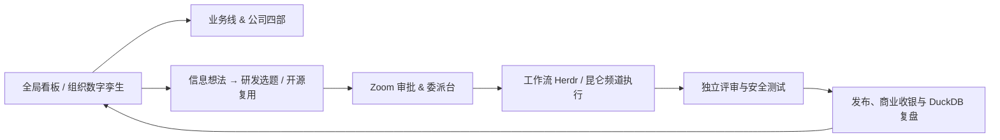
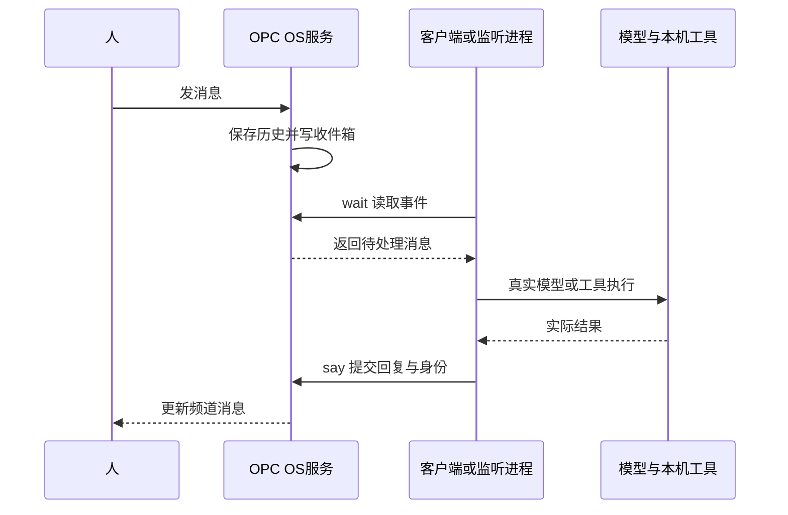
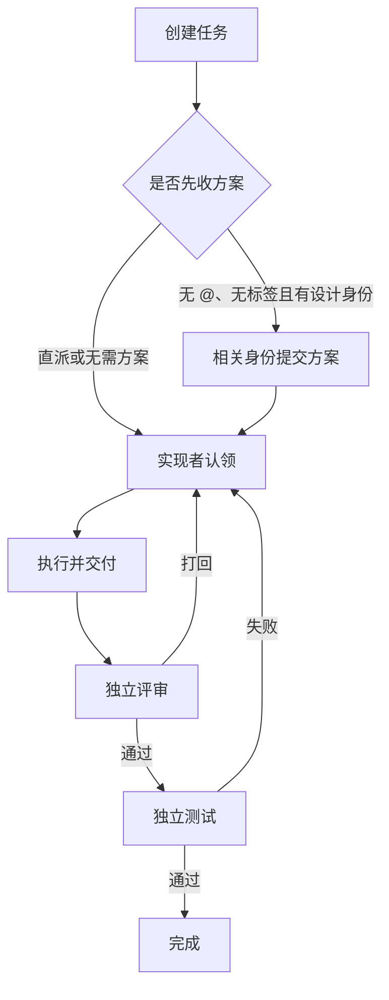

# OPC OS：主使用路线与运行原理

更新于 2026-11-21。

OPC OS 是一人公司的经营总控与多 Agent 协作空间。顶层提供**全局看板、组织数字孪生（35 锚点全息沙盘）、Zoom 统一消息收件箱、全站委派台、商业与治理部等公司四部、5 套业务线打法库、13 阶产研与开源复用**；底层延续**昆仑多 Agent 协作频道**与**自治工作流看板**，让人提出需求，真实客户端交流、执行、交付，其他客户端独立评审和测试，服务端保存历史并协调闭环。[界面设计稿](product/opc-workbench.html) · [7 层蓝图](product/opc-7-layer-blueprint.md) · [首次启动与一键全栈](product/start.md)

## 主使用路线

1. **启动与总览（全局看板 / 组织数字孪生）**：运行 `npm run opc:up` 一键拉起 OPC OS 与 6 大伴生服务（或 `npm run opc:start` 仅起本体）。首页「全局看板」汇总工作现场、多条业务线、公司四部、待办与「产品 × 13 阶段」矩阵；切到「组织数字孪生」（`#digital-twin`）可按空间沙盘、双闭环价值流或 35 入口星图直达任意功能。
2. **商业闭环与公司四部**：在「商业与治理部」（`#commercial`）一键纳管 7 层 18 项资产、套用业务线打法库、签发/验签 Ed25519 离线 License、生成门面与 UTM 推广包、分诊客服工单并同步 DuckDB 漏斗；跨线协同「安全部门」「运维部门」「资源成本部门」把控发版安全、服务探针与套餐额度。
3. **产研流转、Zoom 待办与全站委派**：在「信息与想法」读 `daily-review-learning` 原文并送入研发选题；「开源能力」先查固定版本复用再决定是否向原仓提缺口；所有提问、计划版本、维护需求与实验复盘汇入 Zoom「待我处理」，也可经「委派台」指派给具名 coding agent 或 Agent Home Bot。
4. **昆仑频道与范围设置**：从侧栏底部进入「频道」（`#channels`），按项目建频道，确认项目名、真实工作目录和默认分支。聊天无需目录；代码任务执行前应确认范围。分支字段提供上下文，不表示服务端自动切换分支。
5. **接入真实客户端与交付验收**：在成员管理中选择客户端、多个身份及等级，写入配置并启用；重开会话或运行监听适配器，用真实回复验收。聊天与提问直接发送，勾选「创建任务」写清需求与验收（开发 CLI 普通任务推荐 `@` 直派）；交付后经独立评审与独立测试达成 `done`。

例如先直接发送：`@codex-live 分析频道滚动问题的原因，先讨论，不改代码。`

确认后勾选创建任务，再发：`@codex-live 修复频道列表带动整页滚动。验收：列表滚到顶部或底部时页面不移动，输入框保持可见，手机宽度正常。`

## 原理：消息如何到达真实客户端

只有运行中的客户端才能处理事件。写好 MCP 配置、在成员管理启用、最近有工具调用记录，是不同状态。启用不会自动启动 Desktop 会话。当前没有为所有客户端安装操作系统自启动监听服务。

身份分组显示已启用且非演示的客户端，不按最近在线过滤。活动、启停、等级与身份设置集中在成员管理。分组只列成员，点名字填入频道 @；不混入私聊按钮。

## 身份与任务

客户端是执行者，身份是职责。同一个客户端可以拥有课题研究、产品设计师、设计师、技术架构师、实现、评审、测试中的多个身份，不会因此自动产生多个进程或模型会话。

前四类先提交方案，实现负责结果，评审与测试负责检查。多身份的普通聊天通过 `say.group` 指定本次身份；任务消息按实际职责记录。消息身份随消息保存，之后改设置不会改写历史。旧消息未记录身份的显示「未指定身份」。

实现者不能评审或测试自己的同一任务。没有实际交付引用不能进入评审。一位评审通过可进入测试；测试失败回到修改。并行方案有多个完成结果时需要人裁定，服务端不会自动合并代码。

## 当前边界与新增入口

- 原协议 PRD 在 [PLAN.md](../PLAN.md)，实现说明在 [ARCHITECTURE.md](../ARCHITECTURE.md)。两者部分旧文案与默认演示描述已落后于当前 UI，以代码和明确的测试结果核对。
- 默认不运行演示机器人；历史演示回复明确标注。
- 开发 CLI 自动处理聊天及开发任务，尚不自动承担全部研究、设计、评审和测试阶段。这些阶段需要客户端实际调用协议工具。
- 本工作区新增了按需协调入口：通过 Agent Loop SDK 读取当前频道并生成派发建议，人工确认后创建任务，可取消且防重复应用。它是一次性辅助协调，不是后台常驻管理员；夹具验证不等于真实模型全流程验证。
- 消息区显示最近 300 条，可搜索更早历史；草稿按频道保存。当前没有普通消息嵌套回复、附件上传、跨频道搜索、生产认证和自动合并。
- 本地 Grok CLI 已验证 MCP 握手，但此前模型执行遇到额度耗尽；不能视为已完成真实任务验收。

流程图中的完整协作需要各个客户端真实运行，不承诺仅配置七种身份即可自动完成全链路。

## 验收

2026 年 10 月频道版的验收记录见 [VALIDATION_2026-10-12.md](VALIDATION_2026-10-12.md)。自动化测试分为代码/协议、浏览器交互、真实 CLI 与独立文件结果三类，分别报告。
