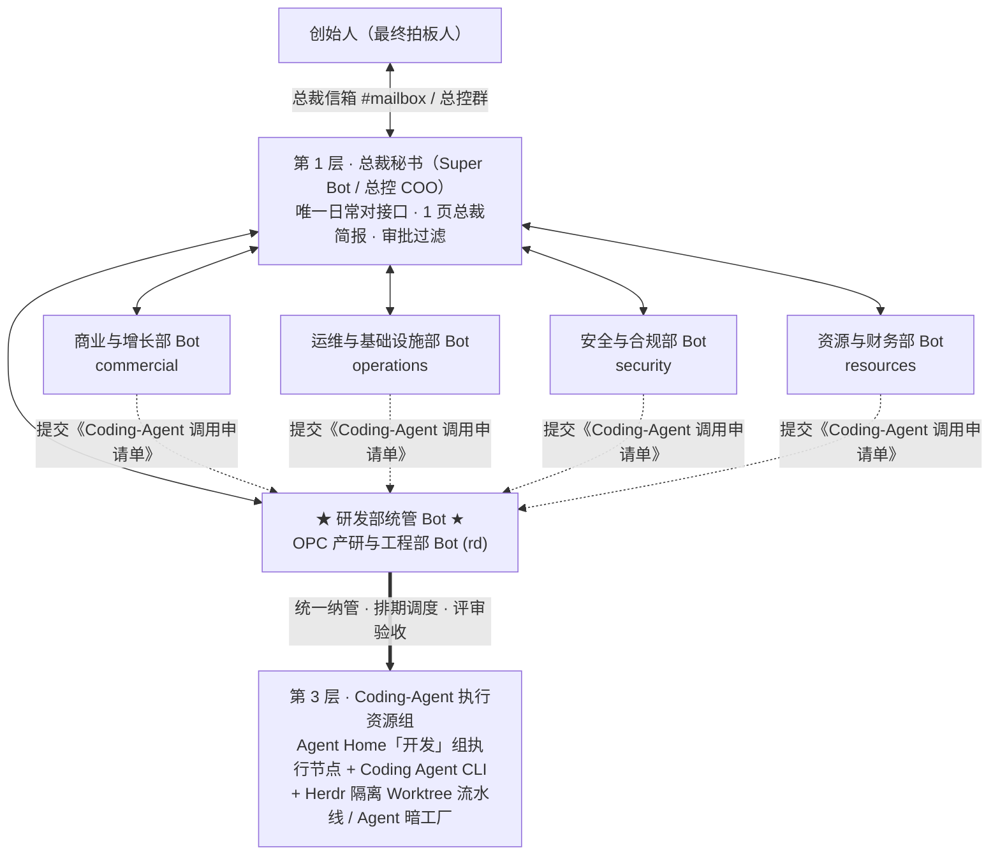

# OPC 三层数字员工组织、总裁信箱与 Coding-Agent 资源组治理架构

> 更新于 2026-11-21。本文档是 OPC OS 组织管理层的事实基准（Source of Truth），供后续开发、排障与 Agent 接入时直接对照，避免出现重复造轮子、越级派单或契约漂移。

---

## 一、三层数字员工汇报链与职责边界

一人公司（OPC）采用**严格三层汇报与授权链**，核心目标是：**让创始人日常只对接 1 位总裁秘书（Super Bot），挡住 90% 的执行细节，把所有编码/脚本算力统一归口给研发部管理**。



### 各层级定位与硬性约束

| 层级 | 角色 | Agent Home 对应实体 | 核心职责 | 严禁越权边界 |
| :--- | :--- | :--- | :--- | :--- |
| **第 1 层** | **总裁秘书 / 总控 COO** | `Super Bot`（`super-bot`） | 直接对创始人负责；通过 `bot_team_status` / `bot_delegate` / `bot_task_results` 调度五大部门统管 Bot，汇总 1 页总裁简报与审批单 | 严禁代创始人批准资金/定价/公开发版/生产高危变更或绕过安全门禁；不在 `bootstrap` 时覆盖原有协调器提示词（仅增量维护起止标记块 `【OPC 总裁办分级管理契约】...【/OPC 总裁办分级管理契约】`） |
| **第 2 层（研发统管）** | **研发部统管 Bot** | `OPC 产研与工程部 Bot`（`rd`） | 对上向总裁秘书汇报；对下**统一管理 Coding-Agent 执行资源组**；受理其他四大部门提交的《Coding-Agent 调用申请单》，审核排期、把关测试与独立评审证据后回执申请部门并抄送总裁秘书 | 重大立项、工作流多步计划批准与最终验收、破坏性重构与对外公开发版必须上报总裁秘书呈创始人拍板 |
| **第 2 层（业务/治理）** | **商业与增长部 Bot** | `OPC 商业与增长部 Bot`（`commercial`） | 1 号商业试点 7 步闭环、订单/离线 License、候补/UTM 漏斗、客服 L1 分诊与业务线实验 | 定价/折扣、人工退款放行、公开渠道正式发布、增删业务线需审批；**写代码/改页面/写脚本必须向研发部提申请单** |
| **第 2 层（业务/治理）** | **运维与基础设施部 Bot** | `OPC 运维与基础设施部 Bot`（`operations`） | Tailscale 机器集群拓扑（直连/中继/GPU/内存）、部署服务实时探针、服务台账与会话索引 | 生产常驻服务重启升级、改 Tailscale Serve 转发/防火墙、删远端数据需审批；**写自动化运维脚本/修代码必须向研发部提申请单** |
| **第 2 层（业务/治理）** | **安全与合规部 Bot** | `OPC 安全与合规部 Bot`（`security`） | 发版前安全评审、整改复核、公开仓脱敏门禁、插件 MV3 最小权限与许可证审计 | 高危泄露立即红色上报；扩大权限或带风险例外放行需创始人签字；**代码级安全修复必须向研发部提申请单** |
| **第 2 层（业务/治理）** | **资源与财务部 Bot** | `OPC 资源与财务部 Bot`（`resources`） | AI 订阅套餐余量/重置窗/登录态失效预警、月固定成本、工作投入与产品营收毛利对比 | 新增/升级/取消订阅、开启超额按需计费、月成本超预算需审批；**统计脚本或仪表盘改动必须向研发部提申请单** |
| **第 3 层** | **Coding-Agent 执行资源组** | 运行时动态发现（见下文） | 承担全公司代码实现、自动化脚本、Bug 修复、测试与独立评审 | 不直接绕过研发部接受外部业务部门零散指令，不跳过独立测试与 diff 验收证据 |

---

## 二、四个核心协同界面的分工边界（禁止重复造轮子）

后续开发必须遵守以下界面边界，**不要在 OPC OS 里重复开发原生聊天客户端**：

| 入口 | 路由 / 地址 | 定位 | 负责什么 | 明确不做什么 |
| :--- | :--- | :--- | :--- | :--- |
| **总裁信箱（Mailbox）** | `#mailbox` (`web/src/FounderMailbox.tsx`) | **创始人异步收发与审批总信箱** | 聚合「你 ↔ Super Bot 指令与 Markdown 简报」「部门回执」「OPC 系统待审批件」；支持未读红点、一键写信/要简报、底部 `批准执行 / 要求修改 / 暂缓拒绝` 批示与自动轮询收信 | 不渲染无关群聊的长篇原始聊天记录和模型思考过程 |
| **总裁办 · Bot 架构** | `#executive` (`web/src/ExecutiveOffice.tsx`) | **三层组织建制与资源组调度台** | 一键幂等建制/同步契约、每日 09:00 定时晨报开关、三层架构图、5 部门单点巡检、**Coding-Agent 执行资源组实时池 + 跨部门调用申请单**、流程协同职能 Bot 池 | 不替代信箱的长文阅读体验 |
| **Agent Home 群聊与 Bot** | `#home-room` (`web/src/HomeRoom.tsx`) | **Agent Home 轻量目录与绑定台** | 左侧双 Tab 列出**全部群聊 + 全部 Bot 成员**（实时在线状态/分组/职责契约）；右侧做 OPC 默认提醒群绑定、群成员增删、新建群聊、以及**一键直达原生 Agent Home** | **禁止在此页重复渲染群聊消息流与思考 trace** |
| **原生 Agent Home** | `http://127.0.0.1:37070/#/bot`（外部服务） | **实时多 Bot 对话与工具调试台** | 承载完整群聊/私聊流式输出、思考过程折叠、工具调用证据、Bot 权限连接配置（`#/agents/bots?bot=<id>&focus=permissions`）与任务流轨迹（`#/tasks/flows?bot=<id>`） | 不直接托管 OPC 商业/业务线/工作流台账 |

---

## 三、后端架构、API 与持久化存储清单

### 1. 总裁办、信箱与 Coding-Agent 资源组（`src/server/executive-bots.ts`）

- **核心类型**：[executive-bots-types.ts](../../src/executive-bots-types.ts)
- **核心服务**：[executive-bots.ts](../../src/server/executive-bots.ts)（挂载于 [zoom-http.ts](../../src/server/zoom-http.ts)）
- **测试覆盖**：[executive-bots.test.ts](../../src/executive-bots.test.ts)（进程内 Mock Agent Home 全链路测试）

| HTTP 接口 | 职责说明 |
| :--- | :--- |
| `GET /api/opc/executive/status` | 返回三层组织在线状态、5 大部门实时脉搏（15s 内存缓存）、`codingResourcePool`（动态发现的开发执行节点 + 在线 CLI）、`codingRequests`（自动同步任务最新状态与回执）与最近 OPC 调度流 |
| `POST /api/opc/executive/bootstrap` | **幂等一键建制/同步**：确保功能分组 `OPC 一人公司部门管理`、先建/更新 `rd` 研发统管 Bot 再更新其他 4 部（写入精确 `rdBotId` 调用规范）、增量合并 `Super Bot` 契约块、写入群共享上下文（`opc-hierarchy` / `opc-coding-pool-protocol` / `opc-approval-policy` / `opc-data-sovereignty-policy`）、确保总控群 `OPC 总裁办 · Super Bot 总控群`（`coordinator` 模式）并绑定 OPC 默认提醒群与默认委派总口、预置默认关闭的每日 09:00 晨报 Cron |
| `POST /api/opc/executive/brief` | 向总控群发送结构化总裁指令并 `@super-bot`（附带当前 OPC OS 实时快照） |
| `POST /api/opc/executive/departments/:id/dispatch` | 以 `Super Bot` 名义向指定部门统管 Bot 派单巡检或下发定向任务（`POST /api/bot-work/tasks`） |
| `POST /api/opc/executive/cron/toggle` | 开关 Agent Home 每日 `09:00 Asia/Shanghai` 总裁晨报定时任务 |
| `GET /api/opc/executive/mailbox` | 聚合总控群消息（含 `turns` 判断 `superBotWorking`）+ OPC 部门任务回执，提取干净标题/摘要、判定 `needsDecision` 并合并按用户存储的已读状态 |
| `POST /api/opc/executive/mailbox/reply` | 在信箱中直接回复/批示 `@Super Bot`（支持 `action: "approve" \| "changes" \| "reject"`），或指定 `departmentId` 转派对应部门 |
| `PUT /api/opc/executive/mailbox/:id/read` | 切换单封信件的已读/未读状态 |
| `GET /api/opc/executive/coding-requests` | 列出最近 20 条跨部门 Coding-Agent 资源调用申请单 |
| `POST /api/opc/executive/coding-requests` | 以申请部门 Bot 名义正式向研发部统管 Bot（`rd`）发起《Coding-Agent 调用申请单》任务并落库 |

### 2. SQLite 表清单

| 表名 | 所在模块 | 用途 |
| :--- | :--- | :--- |
| `opc_executive_state` | `src/server/executive-bots.ts` | 单行 JSON，记录建制后的 `superBotId`、`groupId`、`roomId`、`cronJobId` 与 `departmentBotIds` 映射 |
| `opc_executive_mail_reads` | `src/server/executive-bots.ts` | `(user_id, mail_id)` 主键，持久化总裁信箱的已读记录 |
| `opc_coding_resource_requests` | `src/server/executive-bots.ts` | 跨部门 Coding-Agent 资源调用申请单台账（申请部门、仓库、目标、验收、优先级、关联 `task_id`、实时状态与回执） |
| `opc_home_chat_links` | `src/server/home-room.ts` | OPC OS 与 Agent Home 群聊的范围绑定（`scope_key='default'` 即默认提醒群） |
| `opc_delegate_preferences` | `src/server/delegation.ts` | OPC OS 默认委派路由设置（`bootstrap` 首次默认指向 `super-bot`，`automatic: false`） |
| `company_journal_reads` | `src/server/company.ts` | `(user_id, day)` 主键，持久化「信息与想法」日读文章已读状态（`GET /api/zoom/company/journal` 返回 `readDays`；`PUT .../journal/:day/read` 与 `POST .../journal/read-all`） |

### 3. 配套模块升级要点（同步记录防遗忘）

1. **Agent Home 目录增强（`src/server/home-room.ts`）**：
   - `GET /api/opc/home-chat/overview` 并行补齐 `/api/bot-work/status` 与 `/api/bot-functional-groups`（对旧版或精简 Mock 优雅降级），为前端 `群聊 + Bot 成员` 双视图提供完整在线状态、角色头衔、功能分组与任务计数。
2. **「工作现场」SWR 极速加载（`src/server/company-activity-index.ts` / `company-repos-index.ts` / `company-agents-index.ts` / `web/src/ActivityIndex.tsx`）**：
   - `GET /api/opc/activity-index` 采用内存 Stale-While-Revalidate（30s 新鲜窗口 + 启动冷态公开快照预种），避免 15 分钟后台同步或网络波动阻塞页面；
   - 缓存 `readWorkspaceCheckouts`（5 分钟）与 `gh config get user`（5 分钟）；收紧超时（Agent Hub `4s`、GitHub GraphQL `10s`）；
   - 前端 `useActivityIndex` 使用 `sessionStorage` 瞬时水合，首屏零白屏等待。
3. **运维集群拓扑与服务探针（`src/server/ops-fleet.ts` / `operations-department.ts`）**：
   - 运行时动态读取 `tailscale status --json`、`tailscale serve status --json`、`~/.ssh/config` 别名与本机 Agent Hub `machines_latest` 遥测，自动匹配伴生服务与台账服务归属机器并实时 HTTP 探测。
4. **资源成本部门额度回退（`src/server/resource-department.ts`）**：
   - 当实时采集返回异常或本地服务离线时，自动从 `hub.db` 的 `quota_snapshots` 恢复未过期窗口、推导月度账期，并将错误归类为脱敏诊断码（如 `auth_expired` / `local_server_offline`），支持前端一键校准。
5. **信息与想法日读未读标记（`src/server/company.ts` / `web/src/CompanyIdeas.tsx`）**：
   - 仅给未读文章显示朱砂红圆点，已读去掉标记；打开停留 `1.2s` 自动标为已读，手动点「标为未读」后在离开当前文章前锁定不自动翻回，支持「只看未读」筛选与「全部已读」。

---

## 四、后续开发必守的工程约定与避坑清单

1. **公开仓库脱敏红线（严格禁止违反）**：
   - 本仓库对应公开远端，**严禁**在任何源码、文档或测试夹具中硬编码个人本机绝对路径、邮箱、公司/内网域名、真实机器名、Tailnet IP、API Token 或 Webhook。
   - Coding-Agent 资源组节点、Tailscale 机器列表、SSH 别名与套餐账号信息**一律在运行时动态发现**；单元测试统一使用合成假名（如 `worker-node-a`、`example.invalid`）。
2. **Agent Home 外观枚举校验**：
   - 调用 `POST /api/bots` 创建 `faceStyle: "soft"` 的 Bot 时，参数必须严格落入 Agent Home 校验集合：
     - `faceShape`: `pebble | squish | capsule | cloud | drop | bean | nub | pillow`
     - `faceColor`: `butter | peach | coral | blush | lilac | sky | mint | sage | sand | ink`
     - `faceExpression`: `neutral | happy | curious | sleepy | wink | content | wide | shy`
3. **Coding-Agent 资源组动态发现规则**：
   - 自动扫描 Agent Home 中名为 `开发`（或 `dev`/`development`）的功能分组内的非隐藏、非测试、非 `super-bot`/非个人秘书 Bot，并合并 `agents` 表中已注册的非演示 Coding Agent CLI。
   - 如需新增一台执行机 Bot 进入资源池，只需在 Agent Home 将其放入「开发」分组即可自动被研发部统管 Bot 纳管，**无需改代码**。
4. **本地热重载注意事项**：
   - `node scripts/zoom-local.mjs` 在前台启动内置服务（不自动 daemonize），重启本机 `:52328` 时先释放监听端口再以后台/独立进程拉起。
   - 任何涉及 `src/server/executive-bots.ts` 契约文案的修改，部署后点击 `#executive` 的「重新同步五部契约与群成员」（或 `POST /api/opc/executive/bootstrap`）即可幂等刷新所有实时 Bot 提示词与共享上下文。
5. **核心回归验证命令**：
   ```bash
   npm run typecheck
   npm run build
   npx tsx --test \
     src/executive-bots.test.ts \
     src/home-room.test.ts \
     src/company-activity-index.test.ts \
     src/company-repos-index.test.ts \
     src/company-ideas.test.ts \
     src/operations-department.test.ts \
     src/resource-department.test.ts \
     src/opc-backup.test.ts
   ```

---

## 五、数据主权架构与无状态执行器规范（防锁定 · 10 分钟迁移清场）

### 1. 架构决策：自有主权区 + 借用无状态算力区（不混编 K8s 集群）

对于一人公司（OPC）跨自有个人设备与外部/借用算力节点（如公司配发 Linux/GPU 开发机）的混合环境，**严禁将外部借用机器与个人主权设备混编为统一 Kubernetes 集群**，原因如下：

1. **所有权与撤离成本**：一旦在借用节点部署共享数据库、etcd、PVC 或常驻密钥，脱离该环境时将面临高昂的脱敏、停服、导库与清场风险。
2. **故障域与网络异构**：跨 macOS 笔记本（可能休眠/切换网络）、Linux 主机与 Windows GPU 节点的跨网段集群维护成本远高于收益；一人公司处于验证与早期变现期，单文件 SQLite / DuckDB + 轻量服务已完全满足性能需求。

因此确立双区物理隔离架构：

```mermaid
flowchart LR
  subgraph Sovereign["自有主权区（个人本机 / 未来个人 VPS）"]
    CoreDB["OPC OS 主库<br/>data/zoom-local/chatroom.db"]
    BizDB["商业 / GTM / 客服库<br/>commerce.db（含 Ed25519 私钥）<br/>gtm.db · opc-ops.db"]
    Analytics["分析库<br/>analytics_events.duckdb<br/>catalog_metadata.db"]
    PersonalState["个人运行态（可选全量）<br/>Agent Hub · Agent Home"]
  end

  subgraph Ephemeral["借用无状态算力区（外部 Linux / GPU 执行节点）"]
    W1["Coding-Agent Worker A<br/>只存临时 Git Worktree + 编译缓存"]
    W2["Coding-Agent Worker B<br/>只存临时 Git Worktree + 编译缓存"]
    W3["GPU / 推理 Worker<br/>只跑无状态模型权重与计算任务"]
  end

  subgraph Vault["个人加密异地备份"]
    Enc["opc-backup-YYYYMMDD.tar.gz.enc<br/>AES-256-GCM + SHA-256 校验清单"]
  end

  Sovereign -->|"下发任务指令 / Git Repo"| Ephemeral
  Ephemeral -->|"只回传 Git Push / 测试证据 / HTTP JSON"| Sovereign
  Sovereign -->|"npm run opc:backup -- --encrypt"| Vault
```



### 2. 「三不留」铁律（已写入五部与 Super Bot 共享契约 `opc-data-sovereignty-policy`）

| 铁律 | 含义 | 责任部门监督 |
| :--- | :--- | :--- |
| **一、不留主库** | 所有 SQLite / DuckDB 主数据库、订单账本、客户记录与个人知识库只保存在自有主权区；外部执行机绝不承担主数据存储 | `运维与基础设施部 Bot` + `安全与合规部 Bot` |
| **二、不留核心私钥与高权凭证** | 离线 License Ed25519 签名私钥、支付/云盘主密钥、长期高权 API Token 仅保留在自有设备；外部执行机如必须调用远端能力，仅给最小权限、随时可单点吊销的细粒度 Token | `安全与合规部 Bot` + `商业与增长部 Bot` |
| **三、不留未推送代码** | 所有在外部执行机产生的代码改动、脚本与文档，必须通过 `git push` 推送至个人 Git 远端仓库；外部节点工作目录默认视为「随时可 `rm -rf` 且零损失」 | `产研与工程部 Bot`（Coding-Agent 资源组统管） |

### 3. 一键在线热备、完整性校验与安全迁移工具（`scripts/opc-backup.mjs`）

本仓库内置零第三方依赖的数据主权迁移工具 [opc-backup.mjs](../../scripts/opc-backup.mjs)（测试覆盖 [opc-backup.test.ts](../../src/opc-backup.test.ts)）：

- **在线热备无锁损坏风险**：对所有活跃 WAL 模式 SQLite 数据库使用 Node 原生 `node:sqlite` 的 `VACUUM INTO` 执行事务级快照热备（无需停服），并逐库执行 `PRAGMA integrity_check`。
- **完整校验清单**：自动生成不含个人绝对路径的 `manifest.json`，记录每个逻辑数据槽位（`opc-os-local` / `opc-os-root` / `opc-commerce` / `opc-gtm` / `opc-ops` / `opc-analytics`，以及 `--full` 模式下的 `agent-hub` / `agent-home`）的文件字节数与 SHA-256 摘要。
- **原生端到端加密**：支持 `--encrypt`（AES-256-GCM + scrypt KDF，口令从 `OPC_BACKUP_PASSPHRASE` 或 `--passphrase-file` 传入），可直接安全同步至个人网盘 / Cloudflare R2 / 移动硬盘。
- **防误覆写恢复**：`restore` 默认开启 `--dry-run` 预演，且强依赖先通过完整 SHA-256 与 SQLite 完整性校验；传入 `--apply` 真正落盘时，会自动把目标位已有旧文件及旧 `-wal`/`-shm` 移存至 `.pre-restore-<timestamp>` 防止数据覆盖或 WAL 错配。

常用命令速查：

```bash
# 1. 默认极速热备全部 OPC 核心主权数据（输出至 gitignored 的 data/backups/）并自动自检
npm run opc:backup

# 2. 整机迁移全量热备（额外纳入本机 Agent Hub 与 Agent Home 运行态库）
npm run opc:backup -- --full

# 3. 加密热备（适合同步个人云盘 / 对象存储）
OPC_BACKUP_PASSPHRASE='你的高强度口令' npm run opc:backup -- --encrypt

# 4. 离线验证任意备份包（校验解密、全部 SHA-256 与所有 SQLite integrity_check）
node scripts/opc-backup.mjs verify data/backups/opc-backup-YYYYMMDD-HHMMSS.tar.gz

# 5. 预演恢复（只打印落盘计划，不写入磁盘）
npm run opc:restore -- data/backups/opc-backup-YYYYMMDD-HHMMSS.tar.gz

# 6. 迁移到新目录或本机正式恢复（自动为旧文件留存 .pre-restore-* 回滚副本）
npm run opc:restore -- data/backups/opc-backup-YYYYMMDD-HHMMSS.tar.gz --target-root /path/to/new-opc --apply

# 7. 查看本机已生成的备份清单
node scripts/opc-backup.mjs list
```

### 4. 10 分钟撤离清场清单（脱离借用算力节点时按序执行）

1. **自有设备热备并异地落盘（2 分钟）**：在个人电脑执行 `OPC_BACKUP_PASSPHRASE='...' npm run opc:backup -- --full --encrypt`，执行 `verify` 确认全绿，并同步一份到个人对象存储/移动硬盘。
2. **确认代码零滞留（2 分钟）**：核对各仓库在外部节点上无未提交/未推送分支（确保全部代码已在个人 Git 远端）。
3. **外部借用节点无痕清场（4 分钟）**：
   - 在外部节点撤销/删除个人 Git SSH Key、GitHub CLI (`gh auth logout`)、AI CLI 凭据与临时环境变量；
   - 在 Tailscale 控制台移除对应借用节点（或在其上执行 `tailscale logout`）；
   - 清理临时项目工作目录与个人 Bot 进程。
4. **新环境或个人 VPS 恢复启动（2 分钟）**：在新设备 `git clone` 仓库 -> `npm run opc:restore -- <archive> --apply` -> `npm run opc:up`，全部业务账本、离线 License 私钥与总裁办组织状态即刻恢复。

### 5. 未来 24×7 演进路径（个人共享中间件）

当 1 号商业试点进入持续对外收单阶段、需要公网 24×7 在线及跨项目共享基础设施（Redis / PostgreSQL / 反向代理 / Webhook 接收器）时：
- **只租用 1 台完全属于个人的轻量 VPS**（月费 \$5–\$15），用单机 **Docker Compose** 部署个人共享中间件与 `opc-commerce-kit` / `opc-gtm-kit` / `opc-ops-kit`；
- 个人电脑作为移动指挥端通过 Tailscale 直连该个人 VPS；
- 任何外部/借用算力节点依然严格保持无状态执行器定位，随时可插拔、零迁移包袱。
